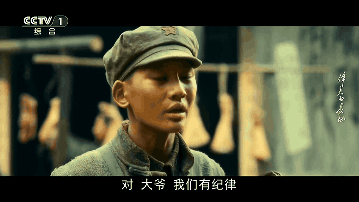

# 大字幕

给华为智慧屏做的「电视字幕放大器」：把机顶盒画面底部的字幕裁出来、放大（倍数可调，演示为 2.5×），再贴回屏幕底部。

起因很简单——家里老人看不清电视剧的字幕，电视自带的设置和无障碍里都没有能调字幕大小的东西。



## 为什么电视设置里调不了

IPTV 机顶盒是把字幕**烧进画面**里输出的。电视收到的只是一路 HDMI 视频信号，它并不知道画面底部那两行是字幕，也就谈不上只放大这两行。所以电视的字幕大小、无障碍选项、系统字体设置，对这个场景全部无效——问题看起来无解，是因为找错了地方。

大字幕换了个位置解：在信号进电视之前拦住它，把字幕那一块单独放大。

## 适合谁

适合：

- 家里有老人看不清电视字幕，而电视和机顶盒的设置里都调不了
- 电视是**华为智慧屏**（已在 Vision 智慧屏 3 上验证；其他 Android TV 理论上可行，未验证）
- 愿意花百元以内买一个 USB 采集卡（需要 UVC + UAC）
- 能用 adb 或 U 盘侧载 APK，能接受装完自己调一次画面位置

不适合：

- 苹果生态、非 Android 的电视
- 想装在电视盒子里、只处理盒子自带播放器的人——本方案处理的是外部 HDMI 输入
- 期望「装上就能用、不用碰任何设置」的人

## 它怎么工作

```
机顶盒 ──HDMI──> USB 采集卡 ──USB──> 智慧屏
                                      ├─ Camera2 取帧（外置 UVC 摄像头）
                                      ├─ USB 音频取声（采集卡自带 UAC）
                                      └─ OpenGL 合成：整幅画面 + 底部放大条
```

关键点：**画面来自采集卡，不是录屏**。所以放大条可以压在字幕区上，不存在「录屏录到自己」的递归问题。全程在本机 GPU 上合成，没有额外的一台电脑要开。

## 硬件

- **电视**：华为 Vision 智慧屏 3（QINL-360A），Android 12 兼容层 / HarmonyOS 3.1
- **采集卡**：MS2130（Hagibis），插 USB 3.0 口，UVC + UAC
- **机顶盒**：运营商 IPTV，音频设「解码 / PCM 立体声」，不要透传

## 遥控器

- `←` / `→`：放大倍数 1.0×–3.0×
- `↑` / `↓`：取景框上下，每档 2%，数字是离画面底部的距离
- `OK`：放大条开关（也是做前后对比时最好用的一个键）
- `菜单键`：条高 8%–30%

调整时顶部弹 2 秒提示，参数存 SharedPreferences。

## 构建

无 Gradle，一条脚本：

```bash
./build.sh     # aapt2 + javac + d8 + apksigner → build/tvzoom.apk
```

需要：Android build-tools 34、platform-31 的 android.jar、JDK 17。

## 安装

```bash
adb install tvzoom.apk
# 或者 U 盘：全部应用 → 媒体中心 → U 盘 → 文件 → 安装
```

首次打开要允许**相机**和**麦克风**两个权限。

## 实测约束

- **分辨率**：1920×1080
- **帧率**：30fps（外置摄像头 HAL 上限，源是 50Hz 时会有轻微规律顿挫）
- **音频延迟**：USB 采集回放约 100ms，实测口型可接受
- **机顶盒音频**：必须「解码」，透传会没声音

## 踩过的坑

1. **Camera ID 每次开机都会变**：华为 HAL 把内置摄像头和采集卡都报成 `LENS_FACING_FRONT`，ID 顺序也不固定。现在按能力识别——采集卡支持 720×576/720×480 这类广播分辨率，内置摄像头只有 16:9 的几档。
2. **开机时 USB 枚举可能漏**：卡在总线上，但相机服务没建节点。App 每 3 秒重试一次，物理拔插一次即可恢复。
3. **焦点背景**：华为启动器认 `huawei_hd_background` 这个私有 meta-data（1920×1080），必须放在 `<application>` 层、改完要换资源名或重启才会刷新。
4. **图标会消失**：卸载重装时启动器会把图标从桌面行移除，覆盖安装不会。

## 关于「放大条」这个设计

最早试过 MediaProjection 录屏 + 悬浮窗叠加，被几何关系卡死：放大条不能压住取景框，否则会录到自己；压不住就取不到字幕。绕不过去，最后换成「自己拿帧、自己合成」，问题才消失。

也想过 OCR 识别文字再重新渲染成高清字幕。放弃的原因很实际：识别会引入延迟、错字、和画面对不齐，而老人看的是一直播下去的剧，字幕晚半秒就没用了。裁切放大不完美，但它零延迟、零错误，而且不需要联网。

后来还查过电视内部：HDMI 输入其实是标准 V4L2 设备（`/dev/video21`，`ndp-hdmi`），
原始帧确实存在且可读，但被 SELinux 的 `camera_device` 标签挡在外面；拿它需要 root，
而 root 又被固件签名和验证启动锁死。完整结论和复现命令见
[docs/hdmi-internals.md](docs/hdmi-internals.md)。

## 目录

```
src/com/robin/tvzoom/
├── CameraZoomActivity.java   采集 + GL 合成 + 音频 + 遥控器交互
└── Config.java               参数持久化
tools/make_icon.py            生成图标和 banner
tools/make_before_after.py    把两帧截图拼成前后对比图
docs/install.md               上门安装指南
docs/hdmi-internals.md        为什么最终用采集卡：HDMI 内部访问研究（V4L2 / 签名 / 投屏）
build.sh                      构建脚本
```

## License

MIT。个人自用项目，不提供技术支持，不接收功能请求。装不上的问题可以先看 `docs/install.md`。
