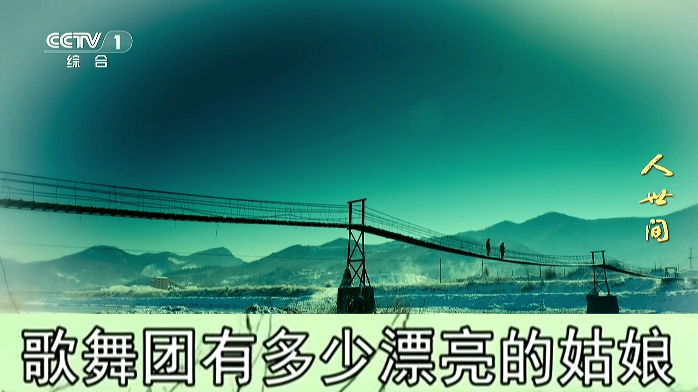

# 大字幕

给华为智慧屏做的「电视字幕放大器」：把机顶盒画面底部的字幕裁出来、放大 3 倍，再贴回屏幕底部。

起因很简单——家里老人看不清电视剧的字幕，电视自带的设置和无障碍里都没有能调字幕大小的东西。



## 它怎么工作

```
机顶盒 ──HDMI──> USB 采集卡 ──USB──> 智慧屏
                                      ├─ Camera2 取帧（外置 UVC 摄像头）
                                      ├─ USB 音频取声（采集卡自带 UAC）
                                      └─ OpenGL 合成：整幅画面 + 底部放大条
```

关键点：**画面来自采集卡，不是录屏**。所以放大条可以压在字幕区上，不存在「录屏录到自己」的递归问题。

## 硬件

| 件 | 型号 | 说明 |
|---|---|---|
| 电视 | 华为 Vision 智慧屏 3（QINL-360A） | Android 12 兼容层，HarmonyOS 3.1 |
| 采集卡 | MS2130（Hagibis） | 插 USB 3.0 口，UVC + UAC |
| 机顶盒 | 运营商 IPTV | 音频设「解码 / PCM 立体声」，不要透传 |

## 遥控器

| 键 | 作用 |
|---|---|
| ← / → | 放大倍数 1.0×–3.0× |
| ↑ / ↓ | 取景框上下（每档 2%，数字是离画面底部的距离） |
| OK | 放大条开关 |
| 菜单键 | 条高 8%–30% |

调整时顶部弹 2 秒提示，参数存 SharedPreferences。

## 构建

无 Gradle，一条脚本：

```bash
./build.sh     # aapt2 + javac + d8 + apksigner → build/tvzoom.apk
```

需要：Android build-tools 34、platform-31 的 android.jar、JDK 17。

## 安装

```bash
adb install tvzoom.apk
# 或者 U 盘：全部应用 → 媒体中心 → U 盘 → 文件 → 安装
```

首次打开要允许**相机**和**麦克风**两个权限。

## 实测约束

| 项 | 值 |
|---|---|
| 分辨率 | 1920×1080 |
| 帧率 | 30fps（外置摄像头 HAL 上限，源是 50Hz 时会有轻微规律顿挫） |
| 音频延迟 | USB 采集回放约 100ms，实测口型可接受 |
| 机顶盒音频 | 必须「解码」，透传会没声音 |

## 踩过的坑

1. **Camera ID 每次开机都会变**：华为 HAL 把内置摄像头和采集卡都报成 `LENS_FACING_FRONT`，ID 顺序也不固定。现在按能力识别——采集卡支持 720×576/720×480 这类广播分辨率，内置摄像头只有 16:9 的几档。
2. **开机时 USB 枚举可能漏**：卡在总线上，但相机服务没建节点。App 每 3 秒重试一次，物理拔插一次即可恢复。
3. **焦点背景**：华为启动器认 `huawei_hd_background` 这个私有 meta-data（1920×1080），必须放在 `<application>` 层、改完要换资源名或重启才会刷新。
4. **图标会消失**：卸载重装时启动器会把图标从桌面行移除，覆盖安装不会。

## 目录

```
src/com/robin/tvzoom/
├── CameraZoomActivity.java   采集 + GL 合成 + 音频 + 遥控器交互
└── Config.java               参数持久化
tools/make_icon.py            生成图标和 banner
docs/install.md               上门安装指南
build.sh                      构建脚本
```

## 关于「放大条」这个设计

最早试过 MediaProjection 录屏 + 悬浮窗叠加，被几何关系卡死：放大条不能压住取景框，否则会录到自己；压不住就取不到字幕。绕不过去，最后换成「自己拿帧、自己合成」，问题才消失。

## License

MIT
